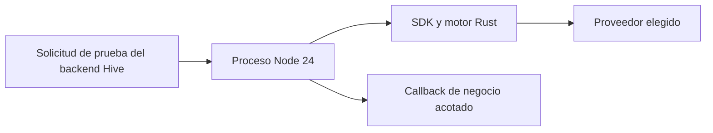

# Cómo probar el SDK con el proyecto local

## Objetivo y alcance

Validar el SDK nuevo con datos/tareas del proyecto local, con bases nuevas, un único coordinador y gasto explícitamente acotado. En este workspace el proyecto de referencia es ../hive. No se modifica su UI, configuración, node_modules ni bases existentes.

Hay tres etapas diferentes:

1. **Consumidor instalado + datos locales, sin gasto:** disponible y probado con [el ejemplo ejecutable](../examples/local-project-validation.mjs). Lee solo name/version del package.json del proyecto y usa un proveedor determinista.
2. **Mismo consumidor con modelo real:** listo para ejecutar cuando se elijan endpoint/modelo/credenciales y presupuesto. No se ha ejecutado aquí.
3. **Flujo de negocio del backend:** necesita un adaptador de prueba. Leer package.json no demuestra que AgentService, canales o toda la aplicación estén integrados.

Consultar [avance y pendientes](progress-2026-11-10.md) para la fotografía de entrega.

## 1. Preparar un consumidor independiente

Comandos para bash en Linux x64, con node/npm de Node >=24 activos. Usar un directorio nuevo fuera del proyecto; no ejecutar npm install dentro de Hive. No hace falta compilar Rust ni instalar Bun para este consumidor.

```bash
export HIVE_SDK_ROOT='/home/johnpaez/Documentos/Agents/Hive/hiveSDK-Rust'
export HIVE_LOCAL_PROJECT='/home/johnpaez/Documentos/Agents/Hive/hive'
export HIVE_TEST_ROOT="$(mktemp -d /tmp/hive-sdk-local.XXXXXX)"
cd "$HIVE_TEST_ROOT"

node --version
node --input-type=module <<'JS'
import assert from 'node:assert/strict';
import { writeFileSync } from 'node:fs';
assert.ok(Number(process.versions.node.split('.')[0]) >= 24);
assert.ok(process.platform === 'linux' && process.arch === 'x64');
writeFileSync('package.json', JSON.stringify({
  name: 'hive-sdk-local-validation', private: true, type: 'module'
}), { flag: 'wx' });
JS

export HIVE_NATIVE_SUFFIX="$(node -p "process.report.getReport().header.glibcVersionRuntime ? 'gnu' : 'musl'")"
npm install --offline --ignore-scripts --omit=optional --no-audit --no-fund \
  "$HIVE_SDK_ROOT/dist/npm/johpaz-hive-sdk-rust-0.1.0.tgz" \
  "$HIVE_SDK_ROOT/dist/npm/johpaz-hive-sdk-rust-linux-x64-$HIVE_NATIVE_SUFFIX-0.1.0.tgz"

cp "$HIVE_SDK_ROOT/examples/local-project-validation.mjs" "$HIVE_TEST_ROOT/validate.mjs"
```

Se instala el facade y el binding correcto de forma explícita porque todavía no están publicados. La importación se resuelve desde los node_modules del consumidor, sin usar el binding debug del checkout. En macOS, Windows o ARM64 este procedimiento queda pendiente de los binarios y validaciones de esas plataformas.

## 2. Ejecutar la primera prueba sin gasto

```bash
HIVE_VALIDATION_MODE=offline node "$HIVE_TEST_ROOT/validate.mjs"
```

Salida esperada:

```json
{"passed":true,"mode":"offline","report":"/tmp/hive-sdk-local.XXXXXX/run-XXXXXX/report.json"}
```

El nombre real del directorio varía. Cada invocación crea run-*/db y report.json nuevos; no reutiliza ni borra una base previa. Las identidades de tenant/agente/sesión son propias de la prueba. El ejemplo rechaza un HIVE_TEST_ROOT situado dentro del proyecto que se está leyendo.

El criterio de éxito es:

- Paquete instalado y binding nativo cargados; versión/ruta/hash registrados.
- Tool leer_proyecto ejecutada exactamente una vez, devolviendo solo name/version del manifiesto configurado. No importa módulos ni inicializa Hive.
- Resultado completed, JSON igual a esos campos y exactamente dos llamadas al proveedor determinista.
- Presupuesto raíz con dos llamadas/una tool; reapertura de Agent sobre el mismo store y conservación de su respuesta sin otra inferencia.
- passed=true y proceso con salida 0. Un fallo produce salida distinta de cero; si el flujo llegó a abrir su directorio de ejecución, guarda su reporte.

En offline, input_tokens=2 y output_tokens=2 son valores sintéticos suministrados por el fixture. No representan tokens del proyecto ni consumo de un modelo. La reapertura comprobada es la de Agent dentro del mismo proceso; no es una prueba de caída/reinicio del proceso ni de recuperación de efectos inciertos.

No borrar el directorio indicado hasta revisar el reporte. Si se desea conservar evidencia después de limpiar /tmp, copiar manualmente el report.json a un directorio de resultados elegido, junto con los hashes de los artefactos usados. El ejemplo conserva también su base de prueba para diagnóstico; no hay limpieza automática de esos resultados.

## 3. Probar un proveedor real

El ejemplo soporta un endpoint compatible con Chat Completions y tools. Para Anthropic/Gemini nativos se debe preparar un caso usando sus clases y contratos específicos; cambiar solo la URL no los vuelve Chat Completions.

Configurar en esta shell o en un archivo privado externo al proyecto:

| Variable | Valor necesario |
| --- | --- |
| HIVE_VALIDATION_MODEL | Identificador explícito de un modelo que soporte tools y los límites elegidos. |
| HIVE_PROVIDER_BASE_URL | Base HTTP(S) del endpoint compatible, incluyendo su prefijo /v1 cuando corresponda. |
| HIVE_PROVIDER_API_KEY | Solo si ese endpoint requiere autenticación. No se recupera del Hive existente. |
| HIVE_OUTPUT_TOKEN_PARAMETER | max_completion_tokens por defecto; elegir max_tokens explícitamente si el endpoint requiere ese nombre. No hay fallback con otra solicitud. |

Esta etapa envía al endpoint la conversación de prueba, definición de tool y los campos name/version. Elegir primero modelo y endpoint; no hay un modelo predeterminado que pueda generar gasto accidentalmente. No hay que poner credenciales en el código, los reportes ni el historial de comandos. El ejemplo no vuelca variables/cabeceras y redacta la API key configurada en el mensaje de error.

Con las variables configuradas:

```bash
HIVE_VALIDATION_MODE=live node "$HIVE_TEST_ROOT/validate.mjs"
```

Opcionalmente, Node 24 puede leer variables de un archivo privado creado por el operador:

```bash
HIVE_VALIDATION_MODE=live node --env-file=/ruta/privada/hive-sdk-test.env "$HIVE_TEST_ROOT/validate.mjs"
```

Los límites del ejemplo son:

| Control | Valor |
| --- | --- |
| Llamadas al modelo | 2, en Agent y Objective |
| Intentos de tool | 1 |
| Salida solicitada por llamada | 128 tokens |
| Salida agregada | 256 tokens |
| Entrada + salida reportadas | 1024 tokens, comprobación según el uso recibido |
| Tiempo | 20 segundos por turno/objetivo; timeout HTTP de 10 segundos |
| Contexto neutral | 16384 bytes |

Estos son límites técnicos, no un máximo garantizado en dinero. El proveedor debe respetar caps y reportar uso; la entrada en bytes no equivale a su tokenizador. Elegir un presupuesto económico antes de llamar y contrastar uso/costo con el proveedor. Un modelo que no respete el prompt, omita la tool, produzca JSON inválido o exceda límites falla la aceptación; no se le pide reparar automáticamente ni se cambia de endpoint/modelo para repetir.

Cada comando crea otro objetivo con otro presupuesto. Repetirlo manualmente puede generar gasto adicional. El ejemplo no hace bucles de pruebas ni reintentos de proveedor. Un fallo de red puede dejar consumo incierto: conservar su reporte/base e inspeccionar antes de decidir otra llamada; ver [checkpoints](checkpoints.md).

## 4. Conectar un flujo del backend local

Hive declara Bun >=1.4.4 y su servicio actual está en packages/core/src/agent/service.ts, con su agent-loop.ts. La compatibilidad directa de este SDK con Bun no está validada. Para el piloto se propone un proceso Node >=24 separado; este puente aún no está implementado.



Procedimiento:

1. Elegir una operación de negocio pequeña, verificable y de lectura. Preparar entradas y resultado esperado antes de invocar un modelo.
2. Crear una entrada de prueba del backend/CLI que envíe una solicitud al consumidor Node; stdout puede devolver JSON con run_id, status, content, stop_reason, stats y elapsed_ms, dejando diagnóstico en stderr. Las credenciales quedan en configuración del proceso.
3. Registrar como tools callbacks de dominio o endpoints locales de prueba con JSON Schema explícito. Sus dependencias y datos deben ser de prueba; no importar el bootstrap/index global de Hive para leer un dato aislado.
4. Usar un único Agent como coordinador, bajo un Objective por tarea. Evitar anidar el agent loop anterior dentro de una tool: sus llamadas no quedarían automáticamente dentro del mismo presupuesto Rust. Revisores, resúmenes, delegación y triggers permanecen desactivados en el primer caso.
5. Guardar el resultado con la misma estructura de evidencia y comprobarlo contra el resultado esperado. Habilitar otras tareas únicamente después de que esa prueba pase.

No es un cambio de imports ni una migración de la base anterior. No ejecutar bun run dev para este piloto: en el proyecto local ese script construye la UI y arranca el flujo completo. La incorporación efectiva al backend se hará en un cambio posterior, con esa entrada de prueba concreta.

## 5. Matriz de aceptación antes de ampliar uso

La primera fila está ejecutada; las siguientes describen el trabajo de aceptación que falta en la integración real.

| Caso | Qué comprobar |
| --- | --- |
| Consumidor offline del manifiesto | completed; datos correctos; dos llamadas simuladas; una tool; historial reabierto. Ejecutado en Node 24. |
| Mismo caso con modelo real | Mismo resultado/efecto, uso medible, latencia y presupuesto respetados. Pendiente. |
| Tarea de negocio de lectura | Resultado validado con datos de prueba y sin UI/bases anteriores. Adaptador pendiente. |
| Límite intencional | Reducir el presupuesto de un caso separado; ninguna llamada/efecto fuera del límite. No reparar reiniciando otro objetivo automáticamente. |
| Cancelación/error de proveedor | Detener nuevos despachos, conservar estado conocido y señalar incertidumbre. No reintentar por defecto. |
| Persistencia tras reinicio real | Reabrir una base creada por el SDK, mismos IDs/configuración, callbacks registrados de nuevo y uso durable conservado. El ejemplo inicial no implementa este reinicio. |
| Tool con efecto externo | Exponer execution_id como clave de idempotencia en la integración y reconciliar un resultado incierto antes de continuar. No habilitar escrituras en el primer caso. |
| Concurrencia | Agentes/sesiones diferenciados, mismo presupuesto raíz cuando comparten tarea y rechazo CAS antes de duplicar efectos. |

Los tests del SDK ya cubren controles de este tipo con fixtures; eso no sustituye probar los callbacks y servicios reales del proyecto. Ver [validación](validation.md), [presupuestos](budgets.md) y [API asíncrona](async-storage.md).

## 6. Evidencia que debemos conservar

El report.json del ejemplo incluye versión del SDK, hash/ruta del binding instalado, versión Node, modo/modelo, políticas, eventos de ciclo de vida, resultado/stats, Objective, efectos de tool, latencia y reapertura. En live registra el origen del endpoint sin credenciales, no su URL completa.

Si falla un paso, el resultado o snapshot pueden faltar; conservar la base para inspección. Los IDs del ejemplo son tenant local-validation, Objective project-metadata, agente project-reader y sesión metadata. No reanudar creando otro objetivo para el mismo efecto incierto. Un error de configuración previo a crear run-* no genera reporte.

Para cada tarea real añadir: identificador de caso, entrada controlada, criterio/resultado esperado, versión de los datos y del modelo, resultado de aceptación, errores/paradas y costo estimado/facturado cuando esté disponible. Distinguir tokens reportados, estimados y ficticios. Registrar también cualquier llamada auxiliar de resumen/verificación y su efecto en la calidad.

El baseline debe ser la ejecución mínima que resuelve la tarea. Comparar candidatos sobre las mismas entradas/modelo, cambiando una política a la vez. No afirmar ahorro por bajar llamadas si también baja la tasa de tareas correctas. El criterio para ampliar el piloto es resultado correcto y gasto observable/acotado, sin efectos duplicados ni continuaciones innecesarias.

## Python como consumidor alternativo

El backend Hive actual hace de Node el camino inicial del piloto. Para comprobar por separado el wheel local, desde una shell con Python >=3.10 usar exactamente un archivo:

```bash
# Linux x64 GNU:
python3.10 "$HIVE_SDK_ROOT/scripts/test-python-install.py" \
  "$HIVE_SDK_ROOT/dist/wheels/johpaz_hive_sdk_rust-0.1.0-cp310-abi3-manylinux_2_28_x86_64.whl"

# Alpine/musl: ejecutar en ese entorno, con su wheel específico:
# python3.10 "$HIVE_SDK_ROOT/scripts/test-python-install.py" \
#   "$HIVE_SDK_ROOT/dist/wheels/johpaz_hive_sdk_rust-0.1.0-cp310-abi3-musllinux_1_2_x86_64.whl"
```

El helper crea un venv temporal e instala sin índices/dependencias; ejecuta el smoke con -I y sin PYTHONPATH. Verifica factories, tools, HiveDB y presupuestos, pero no conecta Python al backend Hive ni hace llamadas reales a modelos. Para usar Python en una tarea de negocio hará falta su adaptador equivalente con Agent/Tool y la misma matriz de aceptación.
